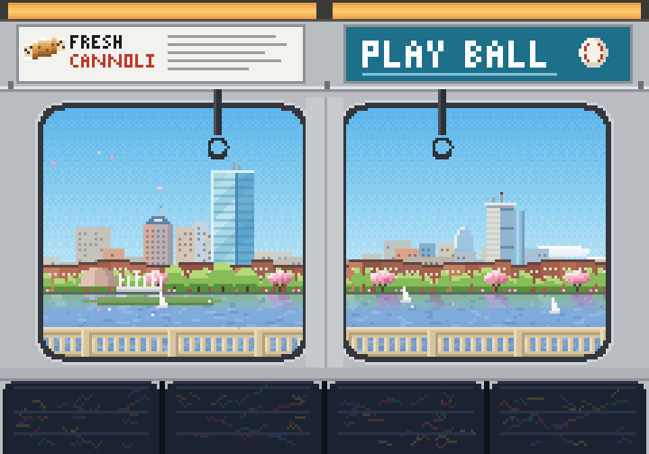
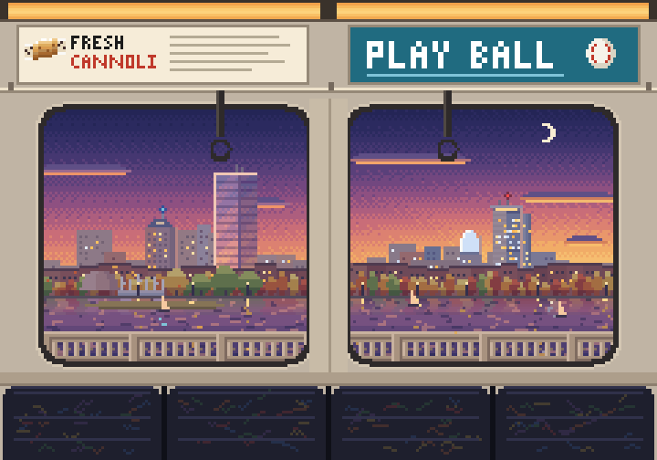
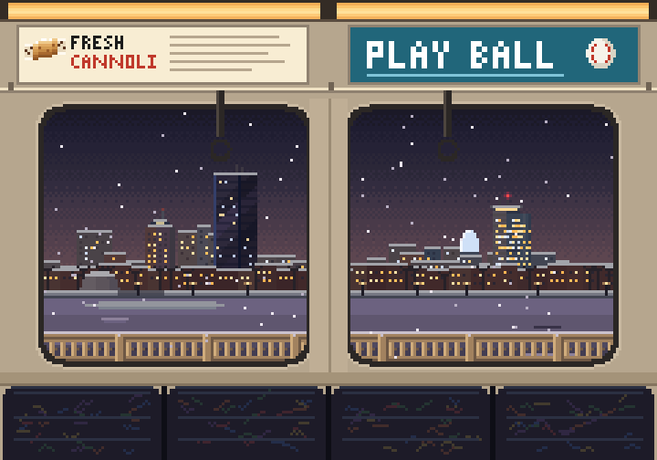
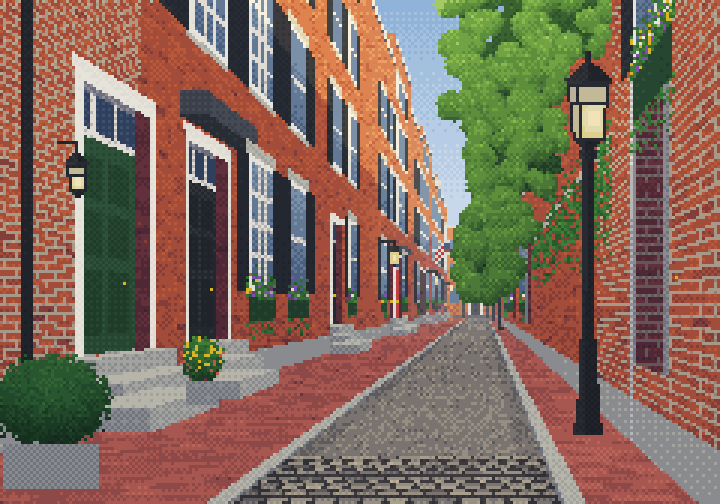
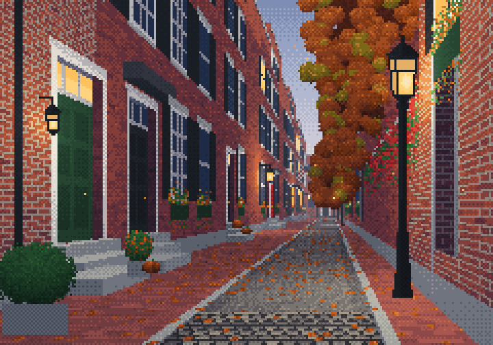
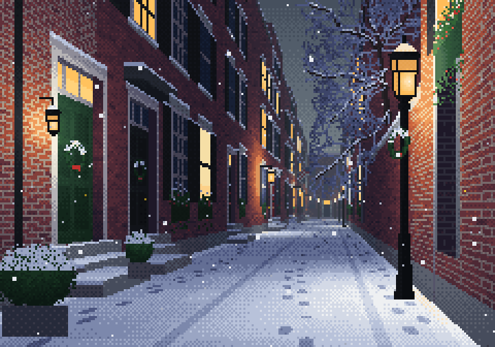

# Window gallery

The lockout screen of [Cooldown](../README.md) ends with a small pixel-art window to look out
of, in place of the feed. Two take turns, switching with every lockout. Each is one
self-contained script (`scene/cooldown-scene.js`, `scene/beacon-hill.js`) drawn on a
240×168 canvas, with the season and time of day taken from the browser's clock.

These are a few of the looks, recorded from the real scripts.

## A train window

A Red Line car crossing a bridge, with the skyline across the water and the railing
sliding past.

| Spring, day | Autumn, dusk | Winter, night |
|---|---|---|
|  |  |  |

## A brick lane

Brick rowhouses, gas lamps and cobbles.

| Spring, day | Autumn, dusk | Winter, night |
|---|---|---|
|  |  |  |

Every scene has all four seasons (spring, summer, autumn, winter) and three times of day
(day, dusk, night). They make no requests and store nothing.
